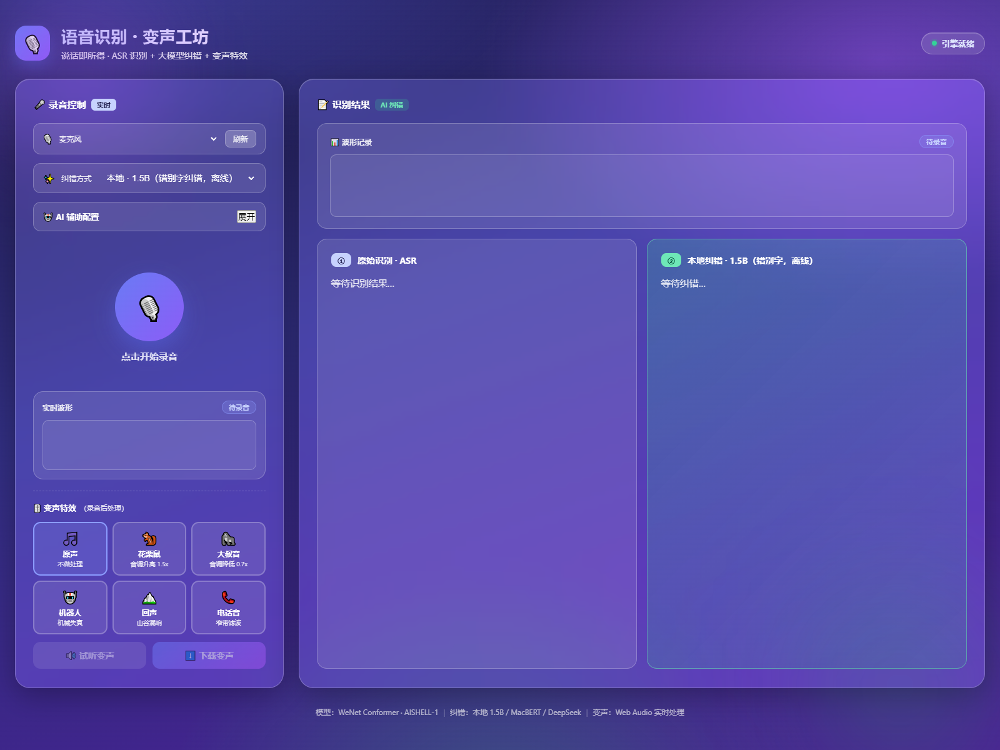
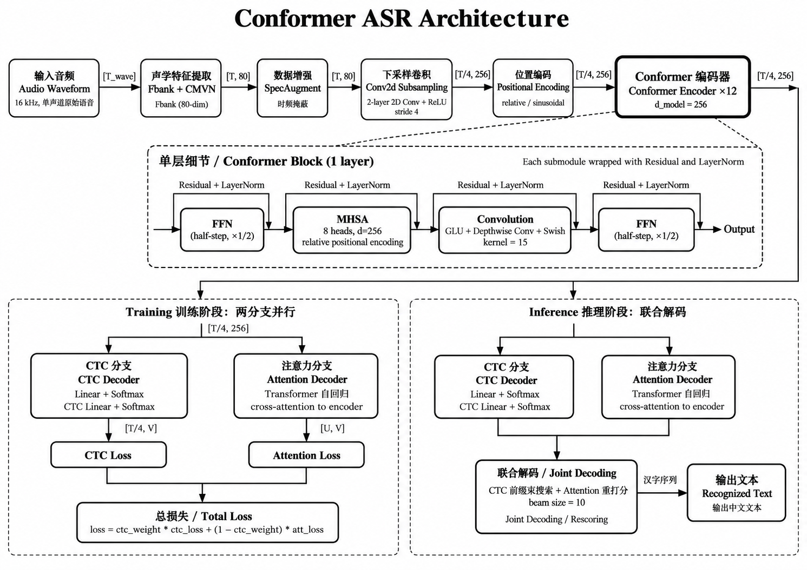
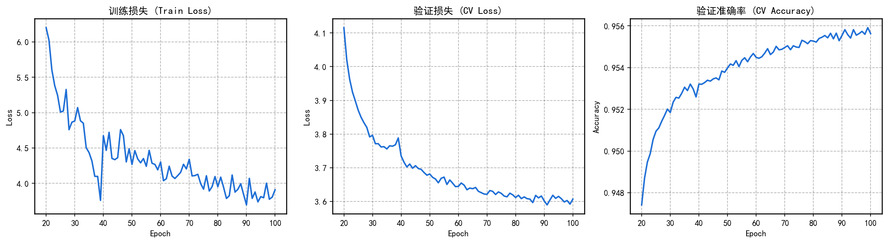

# 🎙️ 语音识别 · 变声工坊

一个本地部署的实时语音识别 Web Demo：说话即可转文字，支持本地 AI 纠错与云端大模型语义整理，附带变声特效与琉璃磨砂 UI。

> 基于 [WeNet](https://github.com/wenet-e2e/wenet) 的 Conformer 模型做端到端语音识别（ASR），纯本地 GPU/CPU 推理，数据不出本机。

## ✨ 功能特性

| 模块 | 说明 |
|---|---|
| **语音识别（ASR）** | WeNet Conformer，`attention_rescoring` 解码（CTC 前缀束搜索 + attention 重打分） |
| **本地纠错 · 1.5B** | `chinese-text-correction-1.5b`（Qwen2.5 基座），字词级错别字/同音字纠错，离线免费 |
| **本地纠错 · MacBERT** | `macbert4csc-base-chinese`，最快，仅做轻量错别字兜底 |
| **云端纠错 · AI 大模型** | 任意 OpenAI 兼容接口（DeepSeek / OpenAI / 通义 / Moonshot…），做断句、补标点、口语整理的**语义级整理** |
| **变声特效** | 纯前端 Web Audio：花栗鼠、大叔音、机器人、回声、电话音，可试听/下载 |
| **实时波形** | 录音中实时波形 + 录音后波形回放 |
| **玻璃磨砂 UI** | 半透明琉璃磨砂质感 + 点击音效，横向双栏布局 |

## 📸 界面截图



## 🧭 目录结构

```
.
├── app.py                  # 后端服务（HTTP + 模型推理）
├── index.html              # 前端页面（单文件，含全部 JS/CSS）
├── config.example.json     # 配置模板（复制为 config.json 填写）
├── infer.py                # 命令行单条识别脚本
├── wenet_local/            # 本地 WeNet 包
├── asr_model_epoch99/      # ASR 模型权重（需自行下载，见下文）
│   ├── final.pt            #   Conformer 权重
│   ├── train.yaml          #   模型配置
│   ├── units.txt           #   字表
│   ├── words.txt           #   词表
│   └── global_cmvn         #   特征归一化
└── models/                 # 纠错模型（需自行下载，见下文）
    ├── macbert4csc/
    └── chinese-text-correction-1.5b/
```

## 🔧 环境要求

- Python 3.8+
- PyTorch（CUDA 可选，CPU 也可跑，GPU 更快）
- 8GB+ 显存（GPU 推理含 1.5B 纠错模型时）；仅 ASR 或 CPU 模式可更低

依赖安装：

```bash
pip install torch numpy scipy transformers
```

## 🏗️ 网络架构

本项目的 ASR 模型是 WeNet 的 **Conformer**，采用 **CTC/Attention 联合架构**（Joint CTC/Attention），解码时用 `attention_rescoring`（CTC 前缀束搜索 + Attention 解码器重打分）。



| 模块 | 配置 |
|---|---|
| **输入特征** | 80 维 mel-filterbank（Fbank），16 kHz，25ms 帧长 / 10ms 帧移 |
| **数据增强** | SpecAugment（时间/频率掩码）+ Speed Perturb（速度扰动） |
| **下采样** | 2 层 Conv2d，时间分辨率降至 1/4 |
| **Encoder** | Conformer，12 层，4 注意力头，256 隐藏维，2048 FFN，卷积核 15，相对位置编码，swish 激活 |
| **Decoder** | Transformer，6 层，交叉注意力（用于重打分） |
| **输出** | 4233 中文字符词表（char tokenizer），CTC + Attention 联合解码（`ctc_weight=0.3`） |

> 详细架构说明与训练细节见下文「训练过程」。

## 📥 模型下载

ASR 权重已通过 **Git LFS** 随仓库一起提交（`asr_model_epoch99/final.pt`，约 190MB）。clone 时若未自动拉取大文件，请先安装 [Git LFS](https://git-lfs.com) 再执行 `git lfs pull`。

### 1. ASR 模型（WeNet Conformer）

权重在 `asr_model_epoch99/`，需包含 `final.pt`、`train.yaml`、`units.txt`、`words.txt`、`global_cmvn`（这些配置/字典文件已随仓库提交）。

> 本项目权重为 AISHELL-1 训练的 Conformer。你也可以用任意 WeNet 导出模型，或参考 [WeNet 官方 AISHELL 教程](https://github.com/wenet-e2e/wenet/tree/main/examples/aishell/s0) 自行训练。

### 2. 本地纠错模型（需自行下载，体积大未入库）

两个本地纠错模型均来自 [pycorrector](https://github.com/shibing624/pycorrector) 项目（作者 **shibing624**），均为 **Apache-2.0** 许可：

- **1.5B 纠错**（`models/chinese-text-correction-1.5b/`）：[shibing624/chinese-text-correction-1.5b](https://huggingface.co/shibing624/chinese-text-correction-1.5b)
  - 基座模型：`Qwen/Qwen2.5-1.5B-Instruct`
  - 规模：约 15.4 亿参数，架构 `Qwen2ForCausalLM`
  - 训练数据：[shibing624/chinese_text_correction](https://huggingface.co/datasets/shibing624/chinese_text_correction)（中文错别字/同音字纠错对）
  - 能力：字词级中文拼写纠错（CSC/CTC），离线推理

- **MacBERT CSC**（`models/macbert4csc/`）：[shibing624/macbert4csc-base-chinese](https://huggingface.co/shibing624/macbert4csc-base-chinese)
  - 基座模型：MacBERT（BERT 变体），约 1.02 亿参数
  - 训练数据：SIGHAN13/14/15 + Wang271K 中文纠错数据集（约 27 万条）
  - 能力：轻量错别字兜底，速度最快，SIGHAN2015 测试集字符级 F1 达 89.91%

## 🚀 使用

### 1. 配置

```bash
cp config.example.json config.json
# 编辑 config.json，可选填 deepseek_api_key（也可在网页里直接填，见下）
```

### 2. 启动后端

```bash
PYTHONPATH="wenet_local" python app.py
```

### 3. 打开页面

浏览器访问 `http://127.0.0.1:8000`，授权麦克风后即可说话识别。

## 🤖 AI 辅助配置（云端纠错）

网页左侧「AI 辅助配置」面板可展开填写：

- **API Key**：你的密钥（`sk-...`）
- **Base URL**：接口地址，默认 `https://api.deepseek.com`
- **模型名**：默认 `deepseek-chat`

配置**仅保存在浏览器 localStorage**，不会上传到服务器，也不会提交到仓库。支持任意 OpenAI 兼容的 `chat/completions` 接口。

优先级：网页填写 > `config.json` > 默认值。

## 📝 命令行识别

```bash
PYTHONPATH="wenet_local" python infer.py your_audio.wav
```

## ⚠️ 说明与边界

- 本项目的 ASR 模型在 AISHELL-1（标准普通话朗读）上训练，对**日常白话**识别较好，但对绕口令、专有名词（人名/地名）、重度口音的鲁棒性有限，这是模型规模与训练数据决定的边界。
- 云端大模型纠错是「补救」ASR 的错误，最终效果上限仍取决于 ASR 识别质量。
- 本地 1.5B / MacBERT 仅能做**字词级**纠错，无法做断句与语义重组（后者需云端大模型）。

## 🎓 训练过程

### 数据与配置

- **数据集**：[AISHELL-1](https://www.openslr.org/33/)（希尔贝壳，178 小时中文普通话朗读，含约 400 位说话人）
- **训练框架**：WeNet（PyTorch 后端，`torch_ddp` 分布式训练）
- **硬件**：单卡 NVIDIA A6000（48GB 显存）
- **关键超参**：batch_size 32（`accum_grad=2`），Adam 优化器（lr=5e-4），warmup 2000 步，grad_clip 5，max_epoch 240

### 训练曲线（前 100 个 epoch）



| 指标 | epoch 20 | epoch 100 | 最佳（epoch 99） |
|---|---|---|---|
| 训练 loss | 6.20 | 3.91 | — |
| 训练 acc | 0.928 | 0.958 | — |
| 验证 loss | 4.12 | 3.61 | — |
| 验证 acc | 0.947 | 0.956 | **0.9559** |

训练从约 epoch 20 的验证准确率 94.7% 稳步爬升到 epoch 99 的 **95.6%**，此后基本进入平台期——继续训练收益递减，因此本项目在 **epoch 100 左右**提前收敛，选用验证准确率最高的 **epoch 99** 作为最终权重。

### 遇到的困难与经验

1. **训练中断与恢复**：训练过程中多次因环境问题中断，WeNet 的 checkpoint 恢复机制（从 `epoch_*.pt` 续训）保证了进度不丢失，但需注意恢复时学习率调度器、optimizer 状态的正确加载。

2. **日志与指标追踪**：WeNet 默认的 `train.log` 未落盘到预期位置，实际训练输出在独立的重定向日志里。做曲线分析时，`TRAIN info` 摘要行只打印 `lr` 而不打印 loss，需要从逐 batch 的 `DEBUG TRAIN` 行里自行聚合每个 epoch 的平均 loss 与准确率。

3. **loss 震荡**：训练 loss（含 SpecAugment + Speed Perturb 数据增强）在 epoch 40~50 区间有明显震荡，这是数据增强带来的正常噪声；验证集曲线光滑、单调下降，说明模型在正常收敛、未过拟合。

4. **模型能力边界**：该 Conformer（12 层 / 256 隐藏维）在 AISHELL-1 朗读数据上，对**日常白话**识别良好，但对绕口令（p/b 等声母混淆）、专有名词（人名/地名，词表外）、重度口音鲁棒性有限——这是模型规模与训练数据分布决定的，多训几十个 epoch 也无法突破（35→99 epoch 的 acc 仅提升约 0.3 个百分点）。

5. **解码器选择**：初版使用 `ctc_greedy_search`（纯 CTC 贪心）效果不佳，换成 `attention_rescoring`（CTC 前缀束搜索 + Attention 重打分）后对同音字/连续语音有明显提升，这也是 WeNet 的默认最优解码方式。

## 📄 开源许可

本项目代码基于 [Apache-2.0](https://www.apache.org/licenses/LICENSE-2.0) 开源。其中：
- [WeNet](https://github.com/wenet-e2e/wenet) 使用 Apache-2.0
- 模型权重请遵循各自发布者的许可协议
